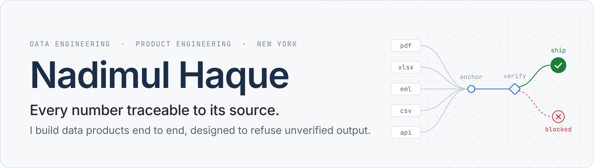
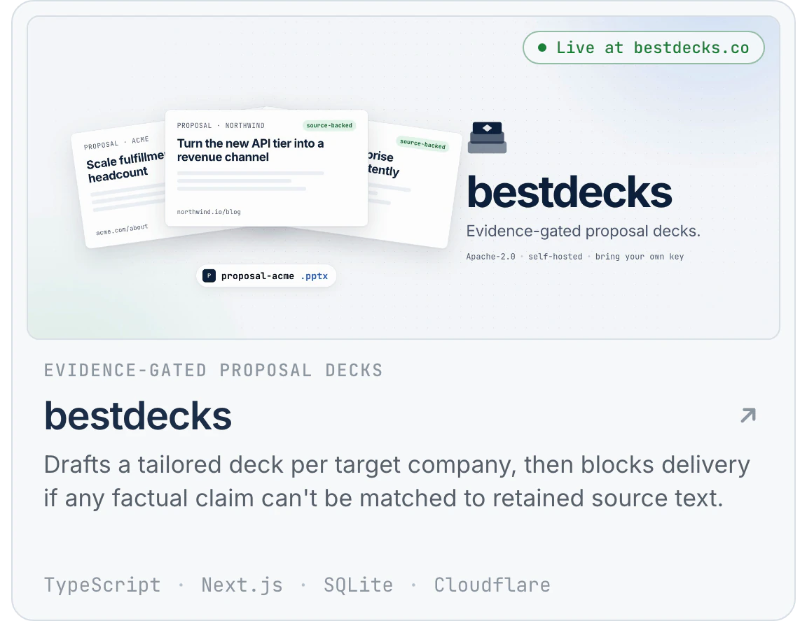
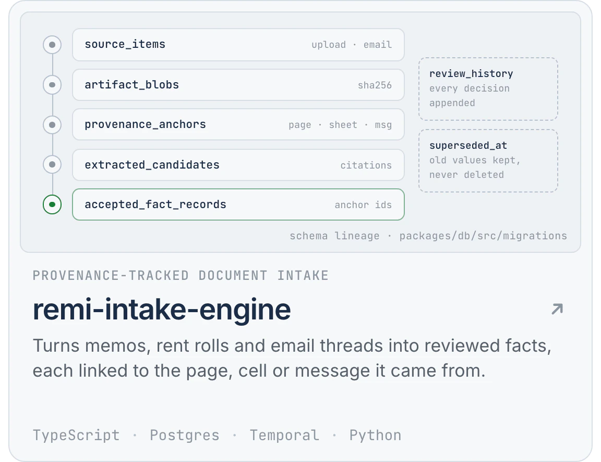
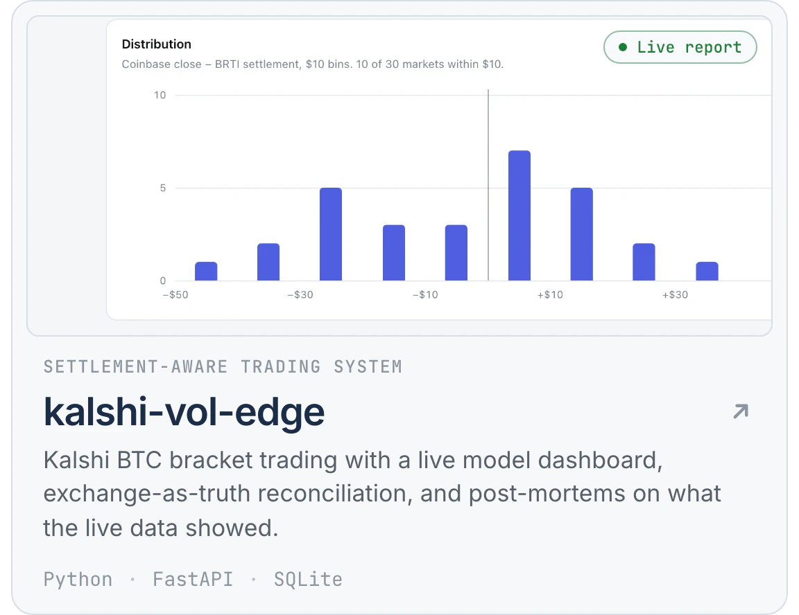

<picture>
  <source media="(prefers-color-scheme: dark)" srcset="assets/banner-dark.svg">
  
</picture>

I build data & AI products end to end that make non-technical people into AI-native SMEs. Based in New York.

### Selected work

<!-- Cards are generated from cards.json by scripts/build-cards.mjs. Rebuild with: npm run build -->

<a href="https://github.com/Nadimul96/bestdecks"><picture><source media="(prefers-color-scheme: dark)" srcset="assets/cards/bestdecks-dark.webp"></picture></a><a href="https://github.com/Nadimul96/remi-intake-engine"><picture><source media="(prefers-color-scheme: dark)" srcset="assets/cards/remi-intake-engine-dark.webp"></picture></a>

<a href="https://github.com/Nadimul96/kalshi-vol-edge"><picture><source media="(prefers-color-scheme: dark)" srcset="assets/cards/kalshi-vol-edge-dark.webp"></picture></a><a href="https://github.com/Nadimul96/slideshow-renderer"><picture><source media="(prefers-color-scheme: dark)" srcset="assets/cards/slideshow-renderer-dark.webp"></picture></a>

### How I work

- **Provenance over polish.** If a number can't be traced to its source, it doesn't ship. In bestdecks a claim counts as source-backed only when its text matches a snippet retained from the source page ([`evidence.ts`](https://github.com/Nadimul96/bestdecks/blob/main/src/domain/evidence.ts)). In remi-intake-engine every accepted fact keeps the anchors that point back to its page, sheet or email ([schema](https://github.com/Nadimul96/remi-intake-engine/blob/main/packages/db/src/migrations/004_provenance_anchors_and_parser_results.sql)).
- **The system of record wins.** Local state is a claim; the exchange's fills are facts. kalshi-vol-edge reconciles against Kalshi and flags phantom orders, missing fills and fees recorded at the wrong rate ([`truth.py`](https://github.com/Nadimul96/kalshi-vol-edge/blob/main/src/kalshi_vol_edge/kalshi/truth.py)).
- **Fail loudly.** A backtest with no recorded data exits instead of falling back to synthetic prices. Malformed model output raises a path-qualified error instead of rendering a broken video.
- **Honest status.** Each repo says plainly what works, what is experimental and what is not built yet. Core logic has tests that need no accounts or API keys.

**Toolbox** &nbsp; Python, TypeScript, SQL &nbsp;·&nbsp; Postgres, SQLite, Temporal &nbsp;·&nbsp; FastAPI, Next.js &nbsp;·&nbsp; Docker, GitHub&nbsp;Actions

[LinkedIn](https://www.linkedin.com/in/nadimul-haque/) · nadimul96@gmail.com
